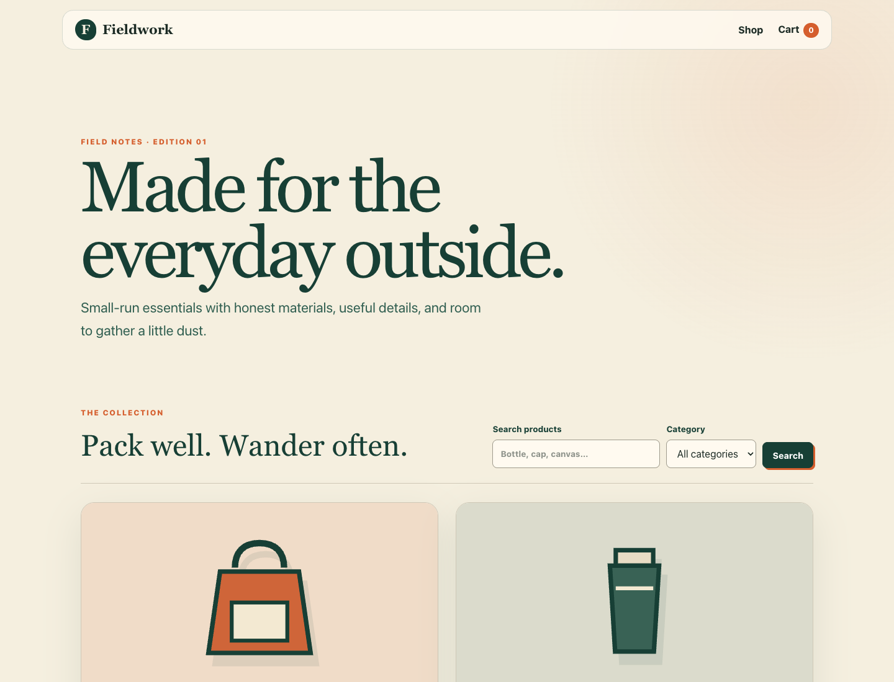

# Fieldwork

A Nuxt 4 and Nuxt UI ecommerce POC with executable Gherkin, Playwright fixtures and page objects, and an agent-friendly affected-test CLI.



## Run the shop

Use Node 24 and pnpm 10.

```sh
pnpm install
pnpm dev
```

Open http://127.0.0.1:3400. Search the catalog, open a product, adjust your cart, and complete a simulated checkout. No real payments occur. Approved checkout clears the cart. Declined checkout preserves it.

## Verify behavior

```sh
pnpm exec playwright install chromium
pnpm check
pnpm verify run --all
```

Playwright builds and starts the application on port 3401. Leave that port free. Each scenario receives an isolated browser context.

## Give an agent a short verification loop

```sh
pnpm --silent verify steps --feature checkout --json
pnpm verify validate
pnpm verify run --scenario checkout-decline-retry
pnpm verify plan --affected
pnpm verify run --affected
```

The step catalog comes from executable Playwright-BDD registrations. The feature argument filters example scenarios, while the complete reusable step vocabulary remains available. Each scenario has a stable `@id:slug` and feature coverage tags. New behavior can be written in Gherkin alone when matching steps already exist.

Use `--base main` to include committed branch changes. The default compares the working tree with HEAD, including staged, unstaged, and untracked files. CI supplies explicit base and head commits. Unknown files or an unavailable comparison select the full suite.

Use `pnpm --silent verify ... --json` for parseable stdout. Reports and traces live under `.verification/<run>/`. See [CLI reference](docs/cli.md), [architecture](docs/architecture.md), and [verification evidence](docs/verification.md).

## GitHub Actions

The workflow always starts and runs static checks. Pull requests run only affected E2E scenarios. Set the repository variable `SHADOW_FULL_SUITE=true` to also run the full suite on each pull request while auditing selection. Main, weekly, and manually dispatched runs execute all scenarios.

Selective PR checks can miss undeclared dependencies. Main and scheduled runs detect those after merge. Enable shadow verification if a full pre-merge suite is required. Configure `Shop verification` as the required check after pushing this repository to GitHub.
